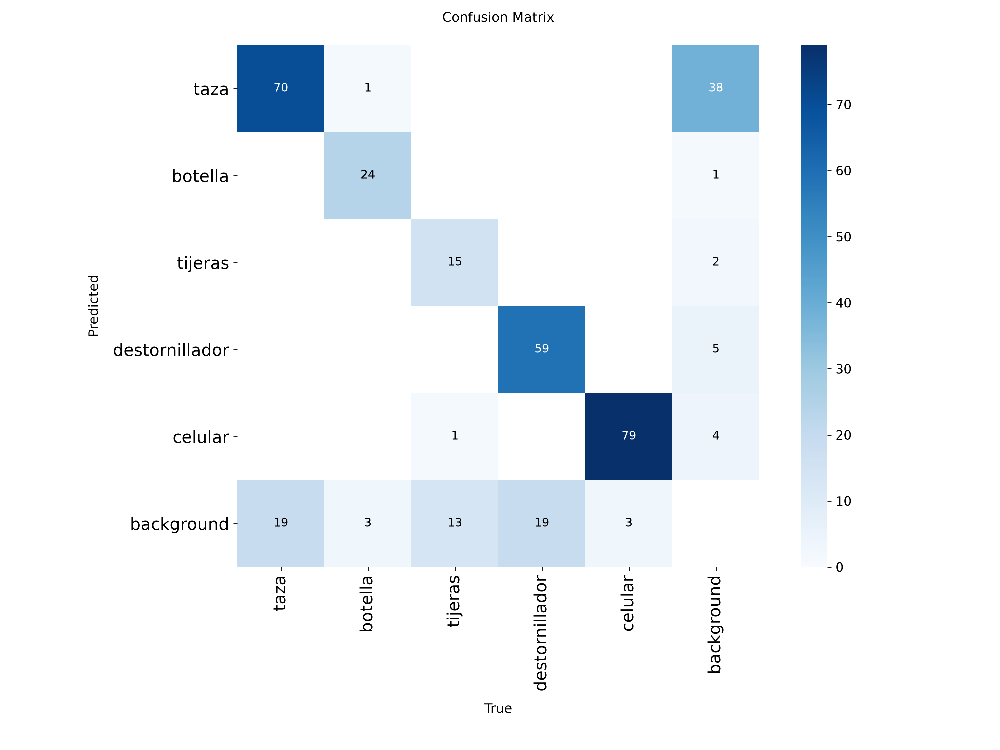

# Métricas

Modelo: `models/best.pt` · split: **test** (separado de train/val) · fecha: 2026-10-09

Reproducir: `python scripts/eval.py --model models/best.pt`

## Resultados por clase (protocolo estándar, conf 0.001)

| clase | precision | recall | mAP50 | mAP50-95 |
|---|---|---|---|---|
| todas | 0.8562 | 0.8064 | 0.8417 | 0.6619 |
| taza | 0.6489 | 0.8306 | 0.7588 | 0.6505 |
| botella | 0.9655 | 0.9286 | 0.9907 | 0.6628 |
| tijeras | 0.8392 | 0.5402 | 0.6608 | 0.5261 |
| destornillador | 0.8908 | 0.7692 | 0.8487 | 0.5966 |
| celular | 0.9365 | 0.9634 | 0.9493 | 0.8735 |

## Precision y recall al umbral de operación (conf 0.4)

| clase | precision | recall |
|---|---|---|
| todas | 0.8743 | 0.7807 |
| taza | 0.6422 | 0.7865 |
| botella | 1.0 | 0.8929 |
| tijeras | 0.8824 | 0.5172 |
| destornillador | 0.9062 | 0.7436 |
| celular | 0.9405 | 0.9634 |

## Matriz de confusión (conf 0.4)

Filas = predicción, columnas = clase real; "fondo" = sin objeto.

| pred \ real | taza | botella | tijeras | destornillador | celular | fondo |
|---|---|---|---|---|---|---|
| taza | 70 | 1 | 0 | 0 | 0 | 38 |
| botella | 0 | 24 | 0 | 0 | 0 | 1 |
| tijeras | 0 | 0 | 15 | 0 | 0 | 2 |
| destornillador | 0 | 0 | 0 | 59 | 0 | 5 |
| celular | 0 | 0 | 1 | 0 | 79 | 4 |
| fondo | 19 | 3 | 13 | 19 | 3 | 0 |

